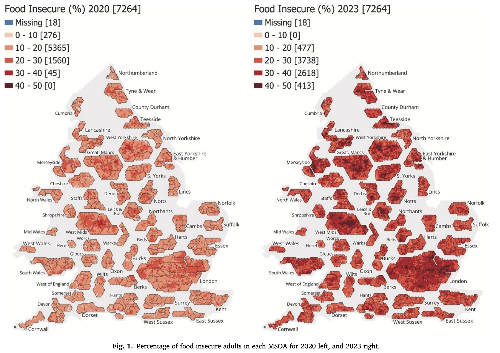

## Important links

- [Paper (OpenAccess)](https://doi.org/10.1016/j.foodpol.2026.103191)
- [Accepted manuscript (White Rose Research Online)](https://eprints.whiterose.ac.uk/id/eprint/245779/)


## Abstract

Rising prices associated with numerous societal shocks in the 2020s have placed a financial burden on many households. One consequence has been the reduced ability for households to afford staples such as food, with growing evidence that food insecurity is increasing. Addressing such insecurity requires effective policy responses, including both targeted support for vulnerable individuals and place-based interventions aimed at struggling neighbourhoods. If the latter approach is adopted, robust measures of neighbourhood food insecurity are required to efficiently target local policy interventions and assess the effectiveness of national policies. This study reports the results of the application of a small area estimation technique, spatial microsimulation, to provide neighbourhood scale estimates of the percentage of adults that self-report as food insecure. The technique combines data that provides a detailed picture of the generic nature of a neighbourhood and survey data that is specifically concerned with food and dietary experiences to produce these estimates. A comparison of these direct estimates of food insecure adults with both proxy food security and general-purpose indicators of deprivation shows good agreement. The study concludes that if an area-based approach to tackling food insecurity is preferred to a more complex individually targeted approach, general-purpose indicators provide a robust basis for identifying neighbourhoods where policy interventions should be prioritised.


## Important figures




## BibTeX citation

```bibtex
@article{clark_producing_2026,
  author = {Clark, S. and Oldroyd, R. and Beecham, R.},
  doi = {10.1016/j.foodpol.2026.103191},
  journal = {Food Policy},
  title = {Producing neighbourhood estimates of food insecurity for England and Wales},
  volume = {144},
  pages = {103191},
  year = {2026}
}
```


